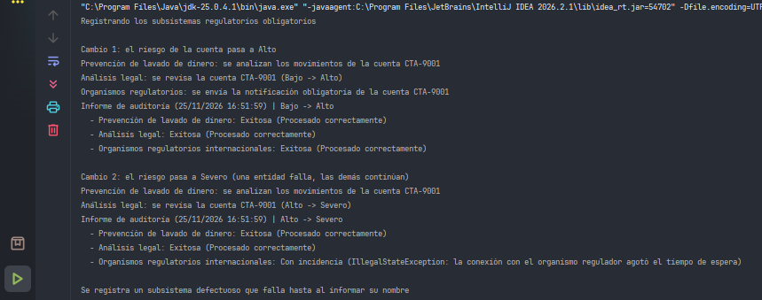
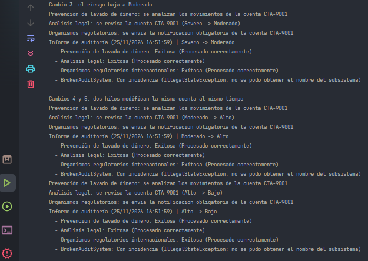
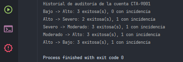

# Ejercicio 10 - Sistema Empresarial de Cumplimiento Normativo y Auditoría de Riesgos

## Descripción

En una institución bancaria global, cada alteración en el perfil de riesgo de una cuenta corporativa debe activar de forma controlada y auditada los subsistemas de prevención de lavado de dinero, análisis legal y notificación a organismos regulatorios internacionales.

## Objetivos

- Desarrollar un Observer de grado empresarial con trazabilidad de eventos críticos.
- Ejecutar de forma secuencial y controlada a todos los observadores obligatorios.
- Registrar de forma inmutable qué entidades fueron notificadas con éxito y cuáles tuvieron incidencias.
- Evitar fallos en cascada y garantizar seguridad en entornos multihilo.

## Implementación del patrón Observer

Se usa la variante robusta con aislamiento de errores y registro de auditoría.

- **Sujeto:** `CorporateAccount` guarda el nivel de riesgo y los observadores en un `CopyOnWriteArrayList`, seguro para varios hilos y que respeta el orden de registro.
- **Ejecución controlada:** `changeRiskLevel` es `synchronized`, por lo que los cambios concurrentes no mezclan sus notificaciones.
- **Aislamiento de errores:** cada observador se ejecuta dentro de su propio `try-catch`, incluida la obtención de su nombre. Si uno falla, se registra la incidencia y se continúa con el siguiente.
- **Observador:** `RegulatoryObserver` declara `getName()` y `onRiskChanged(RiskChange change)`, que puede lanzar excepciones.
- **Observadores concretos:** `AntiMoneyLaunderingSystem`, `LegalAnalysisSystem`, `InternationalRegulatorNotifier` (falla cuando el riesgo pasa a severo) y `BrokenAuditSystem` (falla incluso al informar su nombre).
- **Trazabilidad:** cada cambio genera un `AuditReport` inmutable con un `DeliveryRecord` por entidad. El historial se expone como copia inmutable.

## Propósito de la clase

- `RiskLevel`: niveles de riesgo.
- `RiskChange`: cambio inmutable que reciben los observadores.
- `DeliveryStatus` y `DeliveryRecord`: resultado de cada notificación.
- `AuditReport`: informe inmutable de un cambio completo.
- `RegulatoryObserver`: interfaz común de los subsistemas regulatorios.
- `CorporateAccount`: sujeto observable seguro y auditable.
- `AntiMoneyLaunderingSystem`, `LegalAnalysisSystem` e `InternationalRegulatorNotifier`: subsistemas regulatorios.
- `BrokenAuditSystem`: subsistema defectuoso para probar el aislamiento.
- `Main`: simula cambios secuenciales, fallos y cambios concurrentes, y muestra el historial.

## Concepto clave

Ningún fallo individual puede detener el proceso regulatorio: cada observador está aislado y todo queda registrado en informes inmutables, lo que permite auditar qué pasó con cada notificación.

## Resultado

## Conclusión

Combinar Observer con aislamiento de errores, sincronización y registros inmutables produce un diseño apto para entornos regulados. El sistema es resistente a fallos, seguro en multihilo y totalmente trazable.
